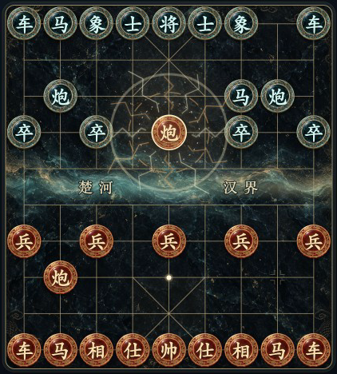

# 象棋教练 · Xiangqi Coach

在对话里下中国象棋、练残局、复盘棋谱。Pikafish 负责计算，当前对话模型根据经过规则验证的变化讲解，正文写回同一块棋盘。

An interactive Chinese chess coach for MCP Apps and Codex, with a local Pikafish engine, verified endgame training, and move-by-move review.

[](LICENSE)
[](https://github.com/Amadeus-ddc/xiangqi-coach/actions/workflows/test.yml)



## 功能

- **对话内下棋**：可点击棋盘、执红/执黑、悔棋、保存与继续、中文着法、PGN/ICCS 导出。
- **残局训练**：93道题，包含18道原创题和75道 CCPD 实战改编题；学习、本地评测、错题重练、3/5分钟及不限时挑战。题目支持多解，完整防守分支经过验证。
- **自由摆谱**：自己走红黑双方，或摆设局面后分析；不必结束对局才能复盘。
- **局势与复盘**：局势曲线、逐手等级、开中残局评分、转折点、失误与经过验证的漏杀。
- **按需讲解**：点击讲解或在聊天中提问才请求模型，使用已验证的着法证据，不自动逐手刷屏。
- **星河皮肤**：平滑走子、起止标记、吃子特效，可关闭并尊重系统的减少动态效果设置。[动图](docs/board-effects.gif)

交互棋盘需要支持 **MCP Apps** 的宿主。插件不需要另一个语言模型 API Key；GPT 讲解由当前对话宿主完成。本地网页只用于操作和验收，不包含聊天模型。

## 快速开始

当前验证平台：**macOS 15+ Apple Silicon、Node.js 22.13+、Xcode Command Line Tools**。

```sh
git clone https://github.com/Amadeus-ddc/xiangqi-coach.git
cd xiangqi-coach
npm ci
npm run setup:engine
npm run build
npm run dev
```

打开 <http://127.0.0.1:9234>。`setup:engine` 从本仓库固定版本 Release 下载 Pikafish 和 NNUE，并校验大小与 SHA-256；不会执行未经校验的下载文件。二进制和权重不放进 Git 历史，完整对应源码位于 [`vendor/pikafish`](vendor/pikafish)。

也可从 [Releases](https://github.com/Amadeus-ddc/xiangqi-coach/releases) 下载包含规则程序、引擎、依赖和许可的 macOS arm64 运行包。解压后可直接运行 `node server/main.mjs --dev` 或注册到宿主；仍需安装 Node.js。

### 在 Codex 中使用

完成上面的安装和构建后，在仓库根目录运行：

```sh
codex plugin marketplace add "$PWD"
codex plugin add xiangqi-coach@xiangqi-coach
```

重新连接插件，或在新聊天中使用。可以直接说：

> 用象棋教练和我下一盘，我执红。我点讲解时再解释。
>
> 来一场三分钟残局挑战。
>
> 我要自己摆一段棋谱，然后帮我复盘。

`.agents/plugins/marketplace.json` 提供本地插件目录，`.codex-plugin/plugin.json` 是插件清单，`.mcp.json` 配置 stdio 服务。**源码仓库必须先安装依赖并构建**，不能把未经构建的 Git 检出当成即装即用的运行包。已经打开的棋盘“刷新”只更新棋局，不替换界面脚本。

### 其他 MCP 宿主

将以下 stdio 服务配置中的路径换成实际绝对路径。交互棋盘依赖宿主的 MCP Apps 支持，只有普通 MCP 支持的客户端仍可调用工具。

```json
{
  "mcpServers": {
    "xiangqi-coach": {
      "command": "node",
      "args": ["/absolute/path/xiangqi-coach/server/main.mjs", "--stdio"]
    }
  }
}
```

也提供仅监听回环地址的 `http://127.0.0.1:9234/mcp`；需要 Bearer 认证，随机令牌保存在数据目录的 `http-token`。默认推荐 stdio，不要将开发预览服务直接暴露到公网。

## 数据与配置

棋局默认保存到 `~/Library/Application Support/XiangqiCoach/games.sqlite`，与 XiangqiNotebook 的棋谱独立；重装不会删除它。插件不自行调用云端模型，也不上传其他应用的棋谱。使用对话讲解时，相关棋局与分析证据会通过 MCP 工具提供给当前对话宿主。

| 环境变量 | 用途 |
|---|---|
| `XIANGQI_DATA_DIR` | 自定义棋局与训练记录目录 |
| `XIANGQI_ENGINE` / `XIANGQI_NNUE` | 自定义 Pikafish 及对应权重路径 |
| `XIANGQI_THINK_MS` | 应手与主动讲解搜索预算，100–5000毫秒，默认700 |
| `XIANGQI_PORT` | HTTP 端口，默认9234 |

## 评分与题库

整局复盘独立实现了已恢复的天天象棋4.4.6.2客户端评分路径，包括分数转换、压缩、分段评分、80/60/40/20等级阈值和阶段划分。逐手原分可为负数，汇总显示下限为−100。使用本地 Pikafish、搜索预算和候选着比较，**不保证与官方同谱同分，也不是官方棋力段位**。旧版本报告保留原口径，可重新生成新评分。[公式与证据](TIANTIAN_RESEARCH.md)

训练分和星级是本地规则：初始1200、K32 Elo，同一题版本只在首次评测作答计分；提示和看答案不算独立完成。CCPD 题目采用 CC BY 4.0，每题保留来源、署名与改编说明。[题库来源与验证](CCPD_DATA.md)

## 开发与验证

```sh
npm run verify   # 构建，并运行规则、真实引擎、题库、交互和持久化测试
npm run package  # 生成 .runtime/releases/ 中的完整运行包
```

仓库自带 MIT 许可的规则和 PGN 解析器测试副本，不依赖旁边另有 XiangqiNotebook 工程。引擎下载器校验固定哈希；[GitHub Actions](.github/workflows/test.yml) 在 macOS arm64 上执行同一套验证。当前验收结果见 [VALIDATION.md](VALIDATION.md)。

修改交互流程时保留版本检查、请求去重和棋谱隔离；新增残局须验证所有合法防守分支。讨论或报告问题请使用 [Issues](https://github.com/Amadeus-ddc/xiangqi-coach/issues)，附操作步骤、平台版本和去除个人信息后的错误输出。

## 已知边界

- 当前预编译运行包只验证了 macOS Apple Silicon。其他系统需要适配 Swift 构建和引擎，尚未声明支持。
- 三次重复局面暂停待裁定，尚未实现完整长将长捉规则。
- 没有官着库；上下界、明显搜索分歧与未验证到终点的疑似杀棋会保留不确定性。
- 工具连接、本地浏览器显示、真实宿主的棋盘与模型回填，是不同的验收步骤。

## 许可与致谢

本项目代码采用 [MIT License](LICENSE)。第三方部分保持原许可：XiangqiNotebook 规则与解析器为 MIT，独立进程运行的 Pikafish 为 GPL-3.0，CCPD 改编题为 CC BY 4.0；详见 [THIRD_PARTY.md](THIRD_PARTY.md)。

棋盘纹理由本项目使用图像生成工具制作，提示词和原素材随仓库保留。仓库不包含腾讯 APK、解密材料、原始业务脚本、官方题库或引擎权重，也不代表或隶属于腾讯。
